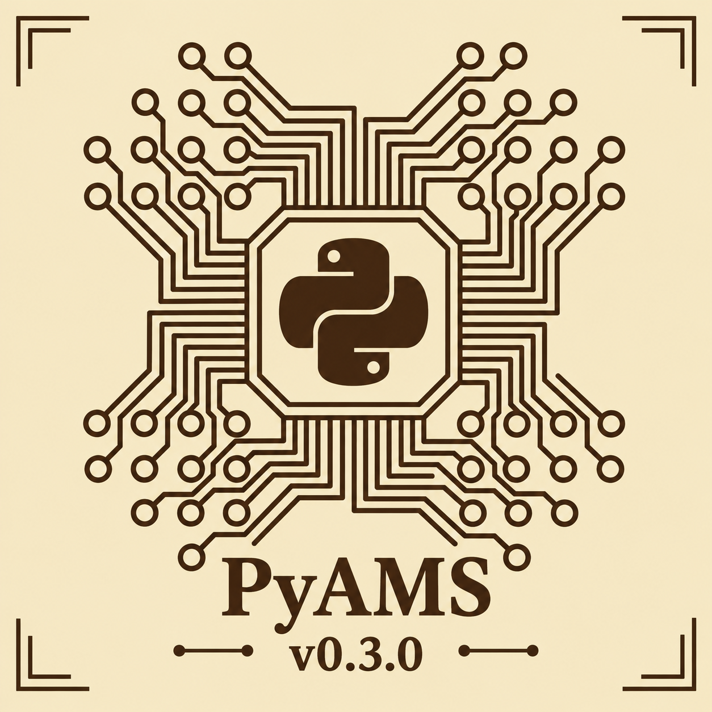

# PyAMS
PyAMS: Python for Analog and Mixed Signals

<h1 align="center">
    
</h1>

---

 
 
  <a href="#Installation">
      =3-blue" alt="Python 3+">
  </a>
    
  

**************
What is PyAMS?
**************

**PyAMS** (*Python for Analog and Mixed Signals*) is an open-source computer-aided design (CAD) system for Python-based circuit simulation. It is built on the `pyams_lib` library, which simplifies the **simulation of electronic circuits** and the **modeling of analog elements**, and it adds a graphical environment with custom-designed symbols.

## Two ways to use PyAMS

There are two ways to use PyAMS:

- As a **Python library** (`pyams-lib`), installed with pip.
- Inside the **CAD system** (the PyAMS application or the VS Code extension).

| Feature | Python library | CAD system |
| :--- | :--- | :--- |
| **What it is** | The `pyams-lib` package, used from your own Python scripts | The PyAMS application, or the PyAMS extension for VS Code |
| **Install** | `pip install pyams-lib` | Download from https://pyams.sf.net, or install the extension in VS Code |
| **You work with** | Python code: models, circuit, analysis | Schematics, symbols, and a waveform viewer |
| **Results** | NumPy arrays, `matplotlib` plots | Interactive Plotly waveforms |
| **The library** | Installed by pip | Already included (only `numpy` and `matplotlib` are needed) |

Both use the same `pyams` library and the same models, so a model written for one works in the other. See the `installation` documentation for details.

## News

**v0.6.0 (Current)2026/11/25**

### Added
- **Digital design and logic waveforms:** a logic waveform viewer in the Time Domain analysis (digital signals shown from the `Y axe outputs`), a new `Digital` symbol category (clock, gates NOT / AND / OR / NAND / NOR / XOR / XNOR, 3-input gates, latches, flip-flops, counter, registers, shift register, LFSR, multiplexers, adders...) and the models `AND3`, `OR3`, `NAND3`, `NOR3`.
- **Buses:** a wire or pin named `D[0:7]` is a bus of 8 lines. Drawing, width check between pins and wires, and the generated netlist (list of nodes) are supported.
- **Mixed-signal converters:** `ADC` / `DAC` symbols and the models `ADC_analog`, `DAC_analog`, `ADC_clocked`, `DAC_clocked`, with an 8-bit ADC, bus and DAC demo.
- **New symbols:** Timer 555, Comparator, and LEDs (Red, Green, Blue, Yellow) with the `LED` model.
- **Symbol editor:** new *Closed path* tool (filled polygon with curved segments).
- **Wire name label:** *Show name* option in the wire properties.
- **New demos:** astable 555, comparator with hysteresis, relaxation oscillator, Hartley and Colpitts oscillators, logic gates with switches and LEDs (live), 8-bit ADC and DAC with a bus.

### Changed
- **Panels:** *List of elements* and *Live simulation* open at the top left like *Symbols library*; Properties stays on the right. Better panel widths, and the symbols library height follows the window.
- **Live simulation:** *Step* and *Speed* are saved in the circuit file.

### Fixed
- **Copy / Cut / Paste:** the context-menu items now work, and copying inside a text box (dialogs, Explorer rename) no longer copies the circuit.
- **Selection box and pin names:** the box of parts containing arcs (XOR, XNOR) and its margins are symmetric; pin names are placed correctly.
- **Junction dots** follow the z-order of the wires.

**v0.5.0**

### Added
- **Switches and relays:** manual switches (SPST, SPDT), voltage- and current-controlled switches (`Switch`, `SwitchV`, `SwitchI`) and relays (SPST, SPDT) with their symbols and models. The switch widgets have a *Line width* property.
- **New symbols:** Zener Diode, Tunnel Diode and Diode Bridge (the `DiodeBridge` model is built with the new `subcircuit()`).
- **New demos:** RC charge / discharge with SPDT and SPST switches (live), a full-wave bridge rectifier fed by a transformer (with discrete diodes and with the Diode Bridge), Zener DC sweep and clipper, and two tunnel diode oscillators. Each demo has a detailed HTML note.

### Changed
- **Better wire (net) editing:**
  - Moving a part keeps its wires attached to the pins; a wire that is no longer straight is broken into horizontal / vertical segments.
  - A dragged wire point never leaves a diagonal segment.
  - Two wires that meet end to end become one wire.
  - Junction dots are drawn where a branch really leaves the other wire, and take the colour of the wire.
  - **Esc** or the **right mouse button** ends the wire being drawn, and the wire tool stays active for the next wire.

### Fixed
- Live simulation of digital models (relays, gates, flip-flops, counters): the digital part was never stepped, so a digital model did not change state.
- A simulation could fail at start when the opened folder contained a Python installation or a copy of installed packages (`numpy`, `scipy`, compiled `.pyd` files).

**v0.4.0** 

- Live simulation runs the circuit with Python: the Live panel starts `pyams/liveSession.py`; switches, buttons and sliders change model parameters while it runs, LEDs / 7-segments / polygon segments and scopes show the results (adjustable step and speed, Pause / Reset).
- Optional `def live(self)` in a model: called after every accepted step to write output parameters for the widgets.
- New live widgets: Gauge, Bar, Value display (outputs) and Rotary knob (input).
- New output widgets for relay circuits: Automatic switch (NO / NC contact) and Automatic transfer switch (changeover), driven by a bound parameter, signal or pin, with an optional dashed actuator arrow.
- Demo: `demo/live/` (LiveDemo, LiveSwitch, Relay and RelayNO models and symbols; Live Demo.dcs and Relay Circuit.dcs circuits).

**v0.3.1** 

1. Updated PyAMS extension for VS Code.
1. Updated **PyAMS software** ([pyams.sf.net](https://pyams.sf.net)).
2. Updated **PyAMS library**.
3. Updated **PyAMS models**.
4. **Documentation Enhancements:** Updated the official documentation ([Read the Docs](https://pyams-lib.readthedocs.io/en/latest/)).

## Key features

- **Free and open source**, distributed under the MIT license.
- **Analyses:**
  1. **DC analysis:** steady-state operating point and DC sweeps.
  2. **Transient (time-domain) analysis:** behavior of the circuit over time.
  3. **AC (frequency-domain) analysis:** small-signal frequency response (magnitude and phase).
- **Interactive visualization** of the results with a Plotly-based waveform viewer, or with `matplotlib` when working directly in Python.
- **Behavioral modeling:** write your own analog elements as Python classes and use them in custom circuit designs.
- **Easy to use:** a simple interface for engineers, researchers, and students, with robust simulation of analog and mixed-signal systems.

## Related projects

- **Documentation:** https://pyams-lib.readthedocs.io/
- **Source code:** https://github.com/d-fathi/pyams
- **Package on PyPI:** https://pypi.org/project/pyams-lib/
- **Circuit design with a graphical (CAD) front-end:** https://pyams.sf.net/

## License

PyAMS is free software distributed under the **MIT** license.

