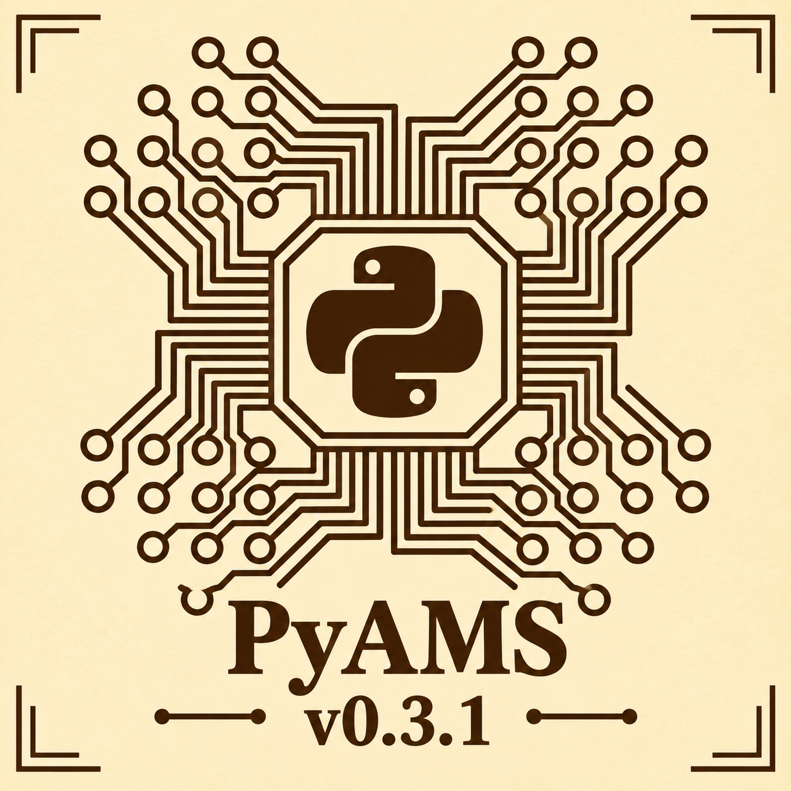

# PyAMS
PyAMS: Python for Analog and Mixed Signals

<h1 align="center">
    
</h1>

---

 
 
  <a href="#Installation">
      =3-blue" alt="Python 3+">
  </a>
    
  

**************
What is PyAMS?
**************

**PyAMS** (*Python for Analog and Mixed Signals*) is an open-source computer-aided design (CAD) system for Python-based circuit simulation. It is built on the `pyams_lib` library, which simplifies the **simulation of electronic circuits** and the **modeling of analog elements**, and it adds a graphical environment with custom-designed symbols.

## Two ways to use PyAMS

There are two ways to use PyAMS:

- As a **Python library** (`pyams-lib`), installed with pip.
- Inside the **CAD system** (the PyAMS application or the VS Code extension).

| Feature | Python library | CAD system |
| :--- | :--- | :--- |
| **What it is** | The `pyams-lib` package, used from your own Python scripts | The PyAMS application, or the PyAMS extension for VS Code |
| **Install** | `pip install pyams-lib` | Download from https://pyams.sf.net, or install the extension in VS Code |
| **You work with** | Python code: models, circuit, analysis | Schematics, symbols, and a waveform viewer |
| **Results** | NumPy arrays, `matplotlib` plots | Interactive Plotly waveforms |
| **The library** | Installed by pip | Already included (only `numpy` and `matplotlib` are needed) |

Both use the same `pyams` library and the same models, so a model written for one works in the other. See the `installation` documentation for details.

## News

**v0.3.1 (Current)** 

1. Updated PyAMS extension for VS Code.
1. Updated **PyAMS software** ([pyams.sf.net](https://pyams.sf.net)).
2. Updated **PyAMS library**.
3. Updated **PyAMS models**.
4. **Documentation Enhancements:** Updated the official documentation ([Read the Docs](https://pyams-lib.readthedocs.io/en/latest/)).

## Key features

- **Free and open source**, distributed under the MIT license.
- **Analyses:**
  1. **DC analysis:** steady-state operating point and DC sweeps.
  2. **Transient (time-domain) analysis:** behavior of the circuit over time.
  3. **AC (frequency-domain) analysis:** small-signal frequency response (magnitude and phase).
- **Interactive visualization** of the results with a Plotly-based waveform viewer, or with `matplotlib` when working directly in Python.
- **Behavioral modeling:** write your own analog elements as Python classes and use them in custom circuit designs.
- **Easy to use:** a simple interface for engineers, researchers, and students, with robust simulation of analog and mixed-signal systems.

## Related projects

- **Documentation:** https://pyams-lib.readthedocs.io/
- **Source code:** https://github.com/d-fathi/pyams
- **Package on PyPI:** https://pypi.org/project/pyams-lib/
- **Circuit design with a graphical (CAD) front-end:** https://pyams.sf.net/

## License

PyAMS is free software distributed under the **MIT** license.

