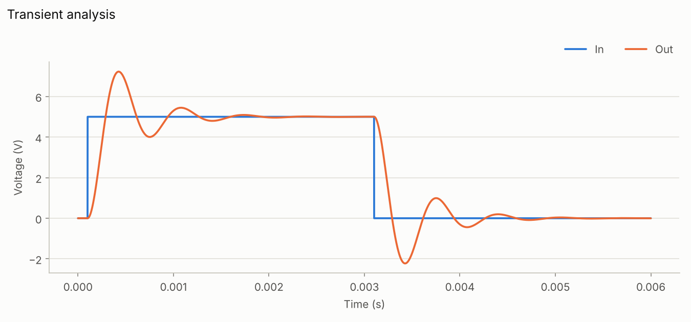
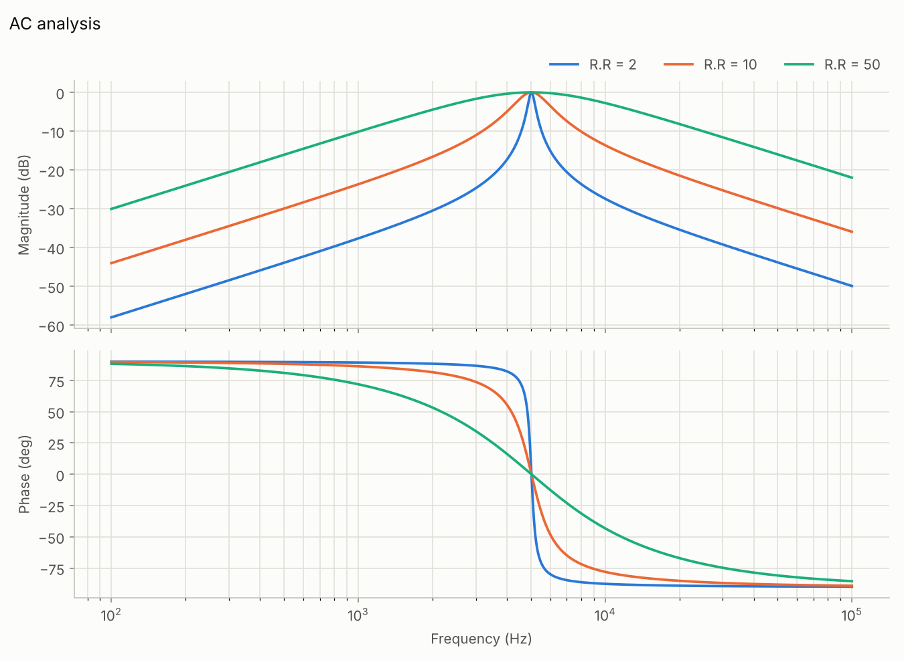
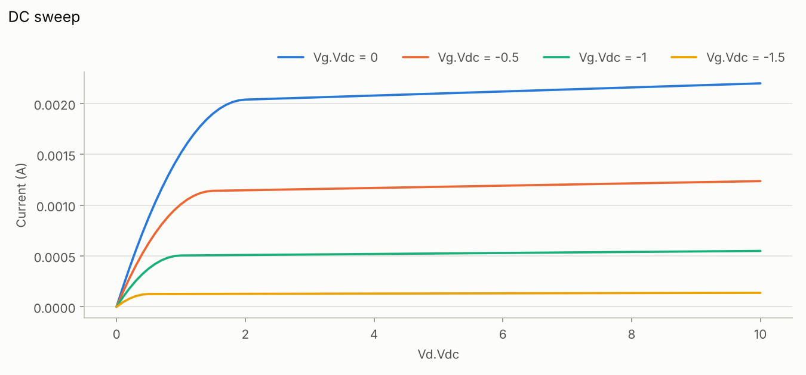
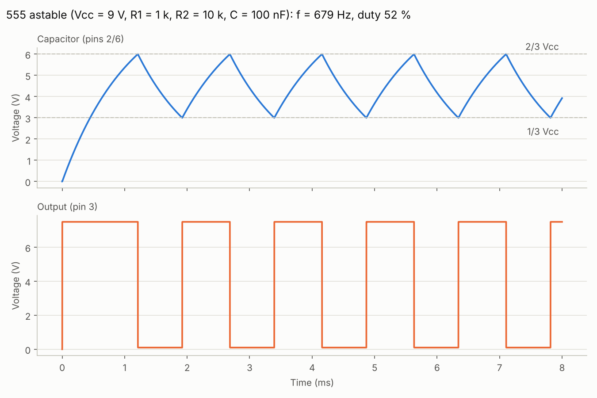
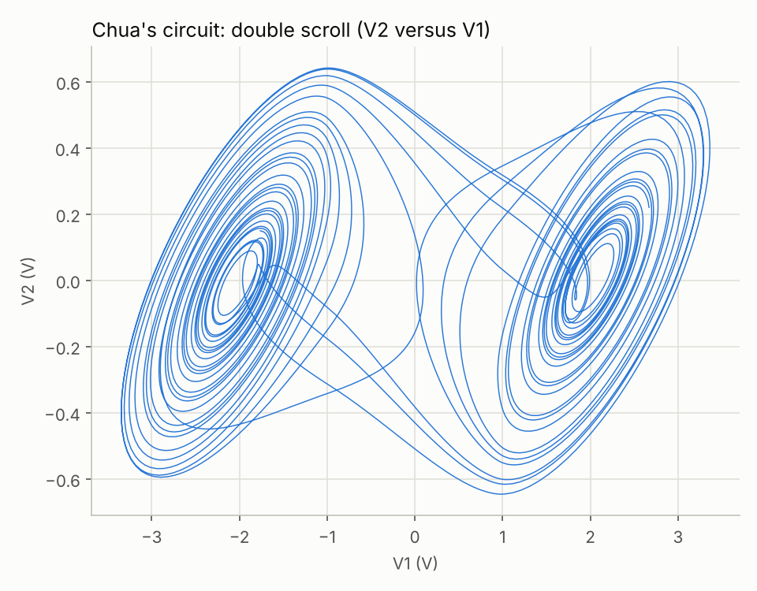

# PyAMS
 Python library for analog and mixed-signal simulation (PyAMS Library)

<h1 align="center">
    <a href="https://pypi.org/project/pyams_lib/"></a>
</h1>

---

<p align="center">

<a href="https://pyams-lib.readthedocs.io/">
    
</a>

 <a href="#News">
    
 </a>
  <a href="#Installation">
      =3-blue" alt="Python 3+">
  </a>

  <a href="#Installation">
      =3-blue" alt="PyPy 3+">
  </a>

  <a href="https://github.com/d-fathi/pyams_lib/blob/main/LICENSE">
      
  </a>
</p>

<p align="center">
  
  
  
</p>

# PyAMS Library

## What is `pyams-lib`?

`pyams_lib` is a Python package designed to simplify the modeling of analog and digital elements and the simulation of electronic circuits. It provides:

- The ability to create custom models of electrical components.
- Simulation of circuits in different modes of operation (DC, DC sweep, transient, AC).
- Visualization of simulation results using `matplotlib`.
- Compatibility with Python 3+, working across Linux, Windows, and macOS.
- PyAMS library (pyams_lib) documentation   <a href="https://pyams-lib.readthedocs.io/">https://pyams-lib.readthedocs.io/</a>.
- For circuit design using the CAD system, visit the software section at <a href='https://pyams.sf.net/'>https://pyams.sf.net</a>.

## Installation

```sh
pip install pyams_lib
```

To upgrade to the latest version:

```sh
pip install --upgrade pyams_lib
```

Requires Python 3 with `numpy` and `matplotlib`.

---

## Contents

1. [Quick start](#1-quick-start)
2. [Modeling](#2-modeling)
   - [Building a circuit](#21-building-a-circuit)
   - [Setting parameters](#22-setting-parameters)
   - [Writing your own model](#23-writing-your-own-model)
3. [Analysis](#3-analysis)
   - [DC operating point](#31-dc-operating-point)
   - [DC sweep](#32-dc-sweep)
   - [Transient](#33-transient-analysis)
   - [AC (small signal)](#34-ac-small-signal-analysis)
   - [Parametric sweep](#35-parametric-sweep)
4. [Showing the results](#4-showing-the-results)
5. [Built-in models](#5-built-in-models)
6. [More examples](#6-more-examples)

---

## 1. Quick start

A half-wave rectifier: a 10 V / 2 Hz sine source, a diode and a 1 kΩ load.

```python
from pyams.lib import circuit
from pyams.models import Resistor, SinVoltage, Diode

# 1. create the elements; the arguments are node names ("0" is ground)
V1 = SinVoltage("In", "0")
D1 = Diode("In", "Out")
R1 = Resistor("Out", "0")

# 2. set their parameters
V1.setParams("Va=10V Fr=2Hz")
R1.setParams("R=1KΩ")

# 3. build the circuit and choose what to record
cir = circuit()
cir.addElements({"V1": V1, "D1": D1, "R1": R1})
cir.setOutPuts("In", "Out")

# 4. choose an analysis, run it, plot
cir.analysis(mode="tran", start=0, stop=2, step=0.001)
cir.run()
cir.plot()
```

The five steps — **elements → parameters → circuit → analysis → results** — are the same
for every circuit.

---

## 2. Modeling

### 2.1 Building a circuit

An element is created with the names of the nodes its terminals are connected to.
Two elements that use the same node name are connected there. The names `"0"`,
`"gnd"` and `"ground"` all mean the reference node.

```python
R1 = Resistor("In", "N1")      # between node In and node N1
C1 = Capacitor("N1", "0")      # between node N1 and ground
```

Elements are then added to a `circuit` as a dictionary `{name: element}`.
The element name is used later to select parameters and signals
(for example `"R1.R"` or `"D1.I"`):

```python
cir = circuit()
cir.addElements({"V1": V1, "R1": R1, "C1": C1})
```

`cir.setOutPuts(...)` selects what is recorded and plotted. It accepts

| Output name | Meaning                                            |
|-------------|----------------------------------------------------|
| `"Out"`     | voltage of node `Out`                              |
| `"R1.I"`    | a signal of an element: `Element.signal` (current) |
| `"R1.V"`    | voltage across the element                         |

If `setOutPuts` is not called, all node voltages are recorded.

### 2.2 Setting parameters

Parameters are set with a string of `name=value` pairs. Values accept engineering
prefixes (`T G Meg k m u n p f`) and optional units:

```python
R1.setParams("R=4.7KΩ")
V1.setParams("Va=5V Fr=50Hz")
C1.setParams("C=100nF")
L1.setParams(L=10e-3)                 # keyword arguments also work
D1.setParams({"Iss": 1e-12, "n": 1.5})  # ... and so does a dict
```

`element.getParams()` returns every parameter with its unit and description;
an unknown parameter name raises an error that lists the valid ones.

### 2.3 Writing your own model

A model is a class derived from `model`.

- `__init__` receives the terminals (node names), declares the **signals** and the **parameters**.
- `analog()` holds the equations.

```python
from math import exp
from pyams.lib import model, signal, param, voltage, current

class MyDiode(model):
    def __init__(self, p, n):
        self.V = signal('in',  voltage, p, n)     # read:  V = v(p) - v(n)
        self.I = signal('out', current, p, n)     # write: current p -> n
        self.Is = param(1e-14,   'A', 'Saturation current')
        self.Vt = param(0.02585, 'V', 'Thermal voltage')

    def analog(self):
        self.I += self.Is * (exp(self.V / self.Vt) - 1)
```

Use it exactly like a built-in element:

```python
V1 = DCVoltage("In", "0");  V1.setParams("Vdc=5V")
R1 = Resistor("In", "A");   R1.setParams("R=1KΩ")
D1 = MyDiode("A", "0")

cir = circuit()
cir.addElements({"V1": V1, "R1": R1, "D1": D1})
cir.setOutPuts("A", "D1.I")
cir.analysis(mode="dc")
print(cir.run())      # {'time': [0.], 'A': [0.692...], 'D1.I': [0.0043...]}
```

**Signals** — `signal(direction, kind, p, n)`

| Declaration                  | Meaning                                                                 |
|------------------------------|-------------------------------------------------------------------------|
| `signal('in',  voltage, p, n)` | the value of `v(p) - v(n)`; read it inside `analog()`                  |
| `signal('out', current, p, n)` | `sig += x` adds a current `x` flowing from `p` to `n` through the element |
| `signal('out', voltage, p, n)` | `sig += x` imposes `v(p) - v(n) = x` (an ideal voltage source)         |
| `signal('in',  current, p, n)` | the current of the `('out', voltage)` signal on the same two nodes (current-controlled elements) |

**Time derivatives.** Inside `analog()`, `ddt(x)` is the time derivative of `x`
(it is 0 in DC), and `idt(x)` its integral. Signals, parameters and `time` behave
like ordinary floats, so `math.exp`, `math.sin`, … can be applied directly.
A capacitor, for instance, is just:

```python
from pyams.lib import ddt

class MyCap(model):
    def __init__(self, p, n):
        self.V = signal('in',  voltage, p, n)
        self.I = signal('out', current, p, n)
        self.C = param(1e-6, 'F', 'Capacitance')

    def analog(self):
        self.I += self.C * ddt(self.V)
```

You only write the equations — the solver builds and linearises the system
(modified nodal analysis with Newton–Raphson; the Jacobian is obtained by finite
differences of `analog()`), so no derivatives have to be coded by hand.

---

## 3. Analysis

The analysis is chosen with `cir.analysis(mode=...)` and executed with `cir.run()`.

| `mode`   | Use it for                         | Main arguments                                  |
|----------|------------------------------------|-------------------------------------------------|
| `"dc"`   | operating point                    | –                                               |
| `"dc"` + `param=` | DC sweep (I–V curves, transfer curves) | `param`, `start`, `stop`, `step`        |
| `"tran"` | behaviour in time                  | `start`, `stop`, `step` (seconds)               |
| `"ac"`   | small-signal frequency response    | `start`, `stop` (Hz), `step` (points / decade)  |

### 3.1 DC operating point

```python
cir.analysis(mode="dc")
res = cir.run()
print(res["A"][0], res["D1.I"][0])
```

### 3.2 DC sweep

Sweep one parameter (`"Element.Parameter"`) and solve the operating point at every value:

```python
cir.analysis(mode="dc", param="V1.Vdc", start=0, stop=5, step=0.05)
res = cir.run()
# res["sweep"] -> swept values, res["D1.I"] -> diode current
cir.plot()
```

### 3.3 Transient analysis

```python
cir.analysis(mode="tran", start=0, stop=0.06, step=1e-4)
res = cir.run()           # {'time': ..., 'In': ..., 'Out': ...}
```

Options for demanding circuits (switching, stiff, oscillators):

| Option            | Effect                                                                      |
|-------------------|-----------------------------------------------------------------------------|
| `order=2`         | second-order (BDF2) integration; default `1` = backward Euler                |
| `adaptive=True`   | the solver chooses its own step (tiny at fast edges, large elsewhere); `step` then only sets the spacing of the output points |
| `lte`, `lte_abs`  | relative / absolute local-error tolerance of the adaptive step               |
| `max_step`        | largest internal step                                                        |
| `reltol`          | Newton convergence tolerance (default `1e-6`)                                |
| `uic=True`        | start from an all-zero state instead of the DC operating point               |
| `progress=True`   | show a progress bar                                                          |

```python
cir.analysis(mode="tran", start=0, stop=0.006, step=1e-6, adaptive=True, order=2)
```

### 3.4 AC (small-signal) analysis

PyAMS solves the DC operating point, linearises every element around it, and solves
the complex system at each frequency. The stimulus comes from the sources that define
an AC value (`ACVoltage`, `ACCurrent`). With a 1 V stimulus, the node phasor *is* the transfer function.

```python
import numpy as np
from pyams.lib import circuit
from pyams.models import ACVoltage, Resistor, Capacitor

V1 = ACVoltage("In", "0")
R1 = Resistor("In", "Out");  R1.setParams("R=1KΩ")
C1 = Capacitor("Out", "0");  C1.setParams("C=1uF")

cir = circuit()
cir.addElements({"V1": V1, "R1": R1, "C1": C1})
cir.setOutPuts("Out")
cir.analysis(mode="ac", start=1, stop=1e5, step=20)    # 20 points per decade
res = cir.run()

f, H = res["freq"], res["Out"]                          # H is complex
gain_db  = 20 * np.log10(np.abs(H))
phase_deg = np.angle(H, deg=True)
fc = f[np.argmin(np.abs(gain_db + 3.01))]               # -3 dB corner: ~159 Hz
cir.plot()                                              # Bode magnitude + phase
```

`scale="dec"` (default) / `"oct"` give `step` points per decade / octave;
`scale="lin"` gives `step` points in total.

### 3.5 Parametric sweep

`cir.sweep(param, list)` repeats the *whole* analysis (transient, DC or AC) for each value
of a parameter. `run()` then returns a list of result dictionaries (each with the extra
key `"param"`), and `plot()` overlays them.

```python
cir.analysis(mode="ac", start=1, stop=1e5, step=20)
cir.sweep(param="R1.R", list=[100, 1000, 10000])
runs = cir.run()                  # one result per resistor value
cir.plot()

cir.sweep()                       # switch the parametric sweep off
```

---

## 4. Showing the results

### Built-in plot

```python
cir.plot()                                   # show a window
cir.plot("result.png", show=False)           # save to a file
```

`plot()` adapts to the analysis: a transient run gives one panel per unit
(voltages, currents) against time, a DC sweep is plotted against the swept parameter,
an AC run gives magnitude and phase against frequency, and a parametric sweep overlays all runs.

| Transient (series RLC, `rlc.py`) | AC (series RLC band-pass, `ac_analysis.py`) |
|:--:|:--:|
|  |  |

### Your own plots and post-processing

`run()` returns plain NumPy arrays in a dictionary, so you can compute anything with them:

```python
import matplotlib.pyplot as plt

res = cir.run()
t, vout = res["time"], res["Out"]

print("peak output: %.3f V" % vout.max())
print("average    : %.3f V" % vout.mean())

fig, ax = plt.subplots()
ax.plot(t * 1e3, vout, label="Out")
ax.set_xlabel("Time (ms)")
ax.set_ylabel("Voltage (V)")
ax.legend()
fig.savefig("out.png", dpi=150)
```

| Analysis        | Keys of the result dictionary                                           |
|-----------------|-------------------------------------------------------------------------|
| `tran`          | `"time"`, then one array per output                                     |
| `dc` (point)    | `"time"` (one value), then one value per output                         |
| `dc` + `param`  | `"sweep"`, `"Element.Parameter"`, then one array per output             |
| `ac`            | `"freq"`, then one **complex** array per output                         |
| with `sweep()`  | a list of the dictionaries above, each with the extra key `"param"`     |

---

## 5. Built-in models

```python
from pyams.models import Resistor, Capacitor, Diode, BJT   # ... see the list below
```

| Group | Models |
|-------|--------|
| Passive | `Resistor`, `Conductor`, `Capacitor`, `CapacitorIc`, `Inductor`, `InductorIc`, `NonlinearResistance`, `Transformer`, `TransmissionLine` |
| Independent sources | `DCVoltage`, `SinVoltage`, `ACVoltage`, `ExpVoltage`, `PWLVoltage`, `TrapezoidVoltage`, `DCCurrent`, `SinCurrent`, `ACCurrent`, `ExpCurrent`, `PWLCurrent`, `TrapezoidCurrent` |
| Controlled sources | `VCVS`, `VCCS`, `CCVS`, `CCCS` |
| Diodes / switching | `Diode`, `ZenerDiode`, `TunnelDiode`, `Diac`, `Thyristor`, `UJT` |
| Transistors | `BJT`, `MOSFET`, `MOSFET4`, `JFET`, `IGBT` |
| Analog ICs | `OpAmp`, `Comparator`, `Timer555` |

Each class documents its terminals, signals and parameters in its docstring:

```python
help(BJT)
print(BJT("c", "b", "e").getParams())
```

---

## 6. More examples

The `examples/` folder contains ready-to-run scripts, each saving a figure:

| Script | What it shows |
|--------|---------------|
| `bridge_rectifier.py`, `zener_regulator.py` | rectification and regulation |
| `rlc.py`, `charge_discharge.py` | transient response of RC / RLC circuits |
| `ac_analysis.py`, `elliptic_filter.py` | AC analysis: RLC band-pass, common-emitter amplifier, op-amp, filters |
| `jfet_curves.py`, `thyristor_iv.py`, `ujt_oscillator.py` | DC sweeps and device characteristics |
| `bjt_astable.py`, `timer555_astable.py`, `ring_oscillator.py` | oscillators and multivibrators |
| `schmitt_opamp.py`, `comparator_demo.py` | comparators and Schmitt triggers |
| `chua_opamp.py`, `van_der_pol.py` | non-linear oscillators / chaos |
| `transmission_line.py`, `thyristor_lamp_dimmer.py`, `igbt_chopper.py` | power and transmission-line circuits |

| 555 astable | JFET output curves | Chua double scroll |
|:--:|:--:|:--:|
|  |  |  |

---

## License

`pyams_lib` is free to use and distributed under the **MIT** license.
